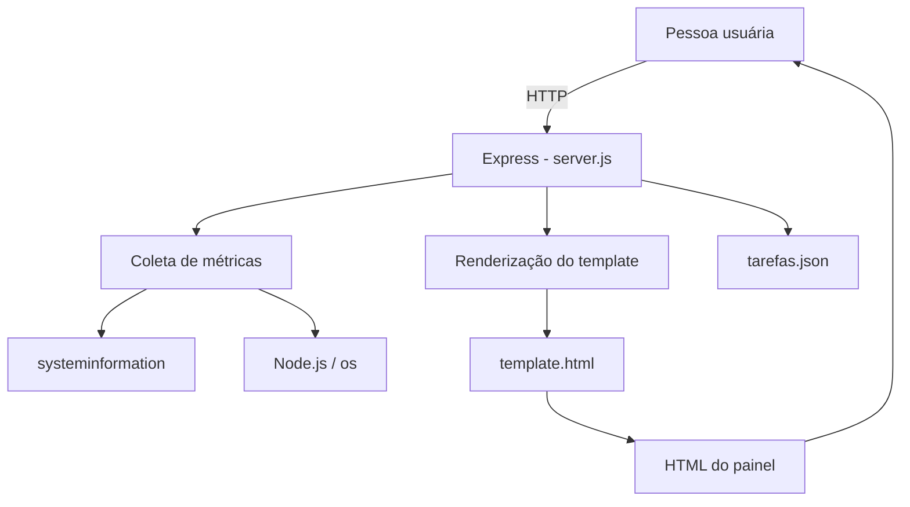
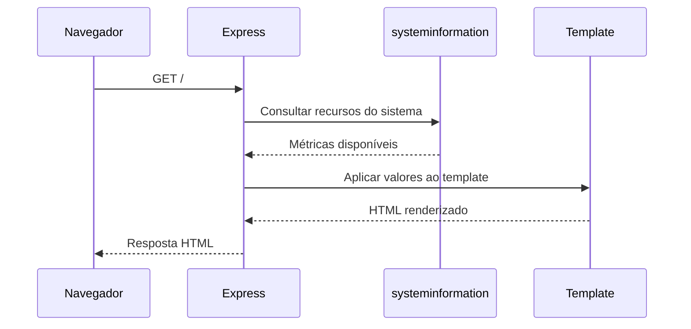
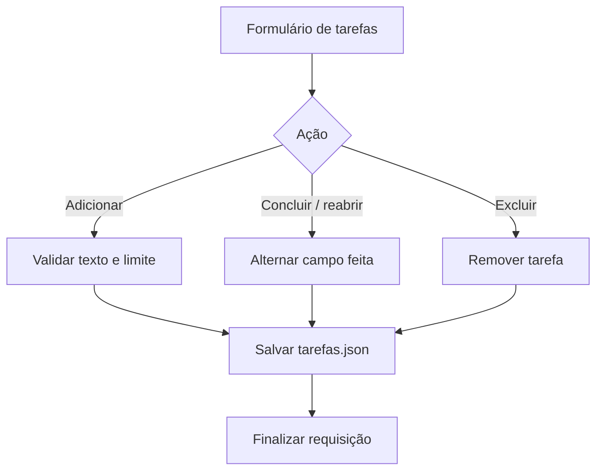

# Diagramas do sistema

Os diagramas abaixo representam o fluxo identificado no código atual.

## 1. Arquitetura simplificada

## 2. Fluxo de carregamento do painel

## 3. Gerenciamento de tarefas

